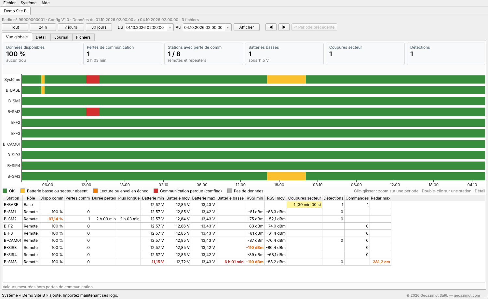
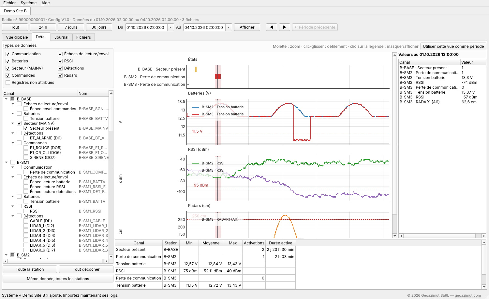

<p align="center">
  
</p>

<h1 align="center">ELPRO Logs</h1>

<p align="center">
  Historique des logs des centrales d'alarme <b>ELPRO 415U-2-C4</b>.
</p>

<p align="center">
  <a href="https://github.com/lucapancottigz/elpro-logs/releases/latest/download/ELPRO_Logs_Setup.exe">
    
  </a>
</p>

<p align="center">
  <a href="https://github.com/lucapancottigz/elpro-logs/releases/latest"></a>
  
  <a href="https://github.com/lucapancottigz/elpro-logs/releases"></a>
  <a href="LICENSE"></a>
</p>

---

**ELPRO Logs** affiche l'historique enregistré par les centrales d'alarme ELPRO 415U-2-C4 : communications, batteries, RSSI, secteur, détections, commandes et radars de chaque station. C'est l'application compagne d'[ELPRO Config](https://github.com/lucapancottigz/elpro-config) : chaque système est décrit par le fichier `.elpro.json` qu'ELPRO Config produit.





## Fonctionnalités

- **Systèmes** : ajout une seule fois à partir du `.elpro.json` ; tous les systèmes se rouvrent au démarrage, un onglet par système.
- **Import des logs** `.log` de la centrale (ainsi que `.zip` et `.csv`) : les valeurs sont gardées dans une base locale, les fichiers d'origine ne sont plus nécessaires. Un fichier déjà importé est reconnu ; un log d'une autre radio n'est importé qu'après confirmation.
- **Période** en heure suisse (été/hiver) : tout, 24 h, 7 jours, 30 jours ou dates libres, avec retour à la période précédente.
- **Vue globale** : chiffres clés, frise des états de chaque station et du système, tableau de synthèse (disponibilité de la communication, batteries, RSSI, coupures secteur, détections, commandes, radars).
- **Détail** : graphiques par station et par type de donnée, axe des temps commun, curseur avec les valeurs à l'instant pointé, statistiques.
- **Journal** des événements (pertes de communication, coupures secteur, détections, commandes, seuils radar, batteries basses, trous de données), avec filtres et export CSV.
- **Fichiers** : logs importés, versions de configuration, liste de log de la centrale.
- **Export CSV** des valeurs, lisible directement dans Excel.

## Installation

1. Cliquer sur le bouton **Télécharger** ci-dessus, ou aller dans [Releases](https://github.com/lucapancottigz/elpro-logs/releases/latest).
2. Lancer `ELPRO_Logs_Setup.exe`. Des droits administrateur sont demandés, car l'application est installée pour tous les utilisateurs du PC.
3. Choisir les raccourcis (bureau, menu Démarrer), puis installer.

> **Avertissement Windows SmartScreen** — L'installateur n'est pas signé numériquement. Windows peut afficher « Windows a protégé votre ordinateur ». Cliquer sur **Informations complémentaires**, puis sur **Exécuter quand même**. Vous pouvez vérifier le fichier téléchargé avec l'empreinte SHA-256 publiée dans la release.

**Configuration requise :** Windows 10 ou 11, 64 bits. Python n'est pas nécessaire. ELPRO Logs et ELPRO Config s'installent et se désinstallent indépendamment.

**Vos données :** toutes les valeurs importées sont dans `Documents\ELPRO Logs\elpro_logs.db`. Pour les sauvegarder, copier ce fichier application fermée ; pour passer à un autre PC, installer ELPRO Logs puis copier le fichier au même endroit.

**Désinstallation :** Paramètres › Applications › ELPRO Logs › Désinstaller. La base `Documents\ELPRO Logs\elpro_logs.db` est conservée.

## Démarrage rapide

1. **Fichier › Ajouter un système (.elpro.json)…** › `examples\demo_site_B.json` (dans le dossier d'installation).
2. **Fichier › Importer des logs…** (`Ctrl+I`) › les 3 fichiers de `examples\logs\`.
3. Vue globale : la perte de communication de B-SM2 le 01.10 apparaît en rouge sur la frise.
4. Double-cliquer sur une station pour ouvrir ses graphiques dans l'onglet Détail.

Les exemples `demo_site_A` et `demo_site_B` sont des sites **fictifs** ; les logs d'exemple sont simulés.

Sur la centrale, la liste de log à configurer est rappelée dans **Aide › Liste de log à configurer sur la centrale**.

## Documentation

| Document | Contenu |
|---|---|
| [Lisez-moi technique](docs/00_LISEZMOI.md) | Organisation du projet et règles de travail |
| [Architecture](docs/01_Architecture.md) | Technologies, moteur, threads, empaquetage |
| [Écrans](docs/02_Ecrans.md) | Chaque écran, chaque contrôle |
| [Stockage](docs/03_Stockage.md) | Base de données, emplacement, sauvegarde |
| [Recette](docs/04_Recette.md) | Tests de validation |
| [Historique des versions](CHANGELOG.md) | Nouveautés de chaque version |

## Développement

Prérequis : Python 3.11, et Inno Setup 6 pour l'installateur.

```bat
py -3.11 -m venv venv
.\venv\Scripts\pip install -r requirements.txt
.\venv\Scripts\python.exe app.py
```

| Commande | Rôle |
|---|---|
| `.\venv\Scripts\python.exe -m unittest discover -s tests -v` | Tests du moteur |
| `.\venv\Scripts\python.exe tests_ui\ui_acceptance.py` | Recette automatique de l'interface |
| `.\build.bat` | Tests, exécutable, vérification, puis installateur dans `dist\` |

## Avertissement

Ce projet est un outil indépendant développé par Geoazimut SàRL. Il n'est ni affilié à ELPRO Technologies ni approuvé par ELPRO Technologies. ELPRO et 415U sont des marques de leurs propriétaires respectifs.

## Licence

**© 2026 [Geoazimut SàRL](https://geoazimut.com). Tous droits réservés.**

L'application compilée peut être téléchargée et utilisée gratuitement. Le code source est publié pour consultation uniquement : toute copie, modification ou redistribution nécessite l'autorisation écrite de Geoazimut SàRL. Voir [LICENSE](LICENSE). Composants tiers : voir [THIRD_PARTY_NOTICES.md](THIRD_PARTY_NOTICES.md).

---

<p align="center">© 2026 <a href="https://geoazimut.com">Geoazimut SàRL</a> · Tous droits réservés</p>
